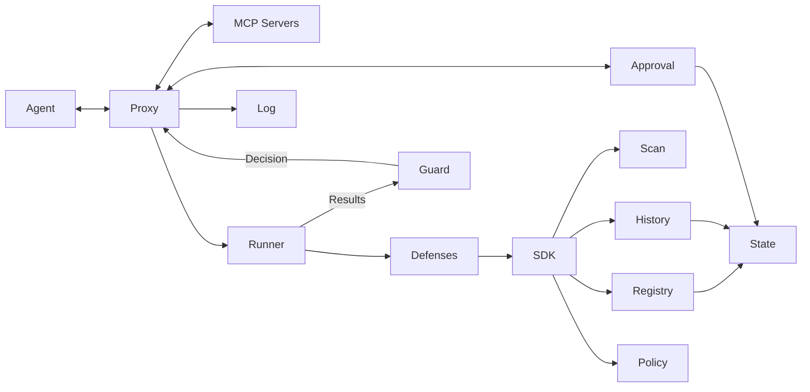

# MCP Security Proxy — Architecture and Build Guide

## Goal

Build an MCP security proxy that supports five independently developed defense categories:

1. **Direct:** malicious instructions in tool definitions, schemas, and server metadata.
2. **Indirect:** malicious instructions in returned content, resources, prompts, and errors.
3. **Cross-tool:** unsafe combinations of operations across tools and servers.
4. **Temporal:** changed definitions, stale trust, and approval reuse outside its scope.
5. **Environment:** untrusted server connections and, when execution is controlled locally, unsafe server execution.

Here, “direct” means metadata-based injection, not malicious user prompts. A normal MCP proxy does not receive the original user conversation.

Developers must be able to add or improve defenses using shared capabilities without modifying the core pipeline. Start with a modular monolith: one application with explicit internal interfaces. Do not introduce microservices or build five separate security pipelines.

This document defines the architecture, not a programming language. Before implementation, select and record the language, MCP SDK and protocol version, initial transport, target client, and local versus remote server scope. Use an existing maintained MCP SDK for protocol behavior. The interface examples below are language-neutral contracts; translate them into idiomatic code in the chosen language.

## Architecture



This diagram shows logical interactions. Runner results reach Guard through Proxy's orchestration; Runner does not need a direct dependency on Guard. SDK is the public interface layer, not a separate runtime service.

All covered traffic must pass through Proxy. A server or agent that can bypass it can bypass its controls. Filtering discovery is insufficient: enforce the same permissions on actual calls.

## Module responsibilities

| Module | Single purpose | Dependencies | Must not do |
| --- | --- | --- | --- |
| **Proxy** | Coordinate the MCP message lifecycle and dispatch authorized messages. | Transport adapters, Identity, Runner, Guard, Registry, History, Approval, Log | Implement attack detection or embed policy rules. |
| **Identity** | Verify connection credentials and resolve the principal. | Configured authentication adapter | Trust an unverified user or agent ID supplied in a payload. |
| **Runner** | Select and execute defenses and collect explicit results. | Defense catalog, SDK context factory | Make authorization decisions or forward messages. |
| **Guard** | Combine policy, inspection results, and authorization context into one decision. | Policy | Scan content, call servers, or grant consent. |
| **SDK** | Define stable contracts and scoped capability interfaces for defenses. | Contract types only | Import concrete core or storage implementations. |
| **Scan** | Provide reusable content analysis. | Configured detector adapters | Decide whether an operation may execute. |
| **Registry** | Manage versioned server records, versioned tool definitions, and configured tool semantics. | State, tool adapters | Treat server claims as verified permissions. |
| **History** | Provide consistent task-scoped operation history and security signals. | State | Act as a free-form log or infer user intent. |
| **Policy** | Provide validated, versioned permissions and enforcement rules. | Configuration provider | Accept policy changes from server content. |
| **State** | Persist scoped records with atomic update guarantees. | Storage adapter | Contain attack-specific reasoning. |
| **Approval** | Manage consent bound to an exact proposed action. | State, trusted approval interface | Override a hard block or authorize altered actions. |
| **Log** | Record sanitized decisions and execution outcomes. | Audit sink | Serve as the live decision-state repository. |
| **Sandbox** — optional | Enforce local server execution restrictions. | OS/container adapter | Claim to control remote server internals. |

Within Proxy, keep transport, codec, and routing adapters separate behind narrow interfaces. They need not be separate top-level services. Proxy remains a thin orchestrator rather than a general-purpose class containing all behavior.

Identity, Policy, and Registry together supply trusted context. Task IDs and task permissions must come from a trusted client integration or configuration. A transport connection is not automatically a user task. If no reliable task boundary exists, document the configured isolation boundary and limit task-specific claims accordingly.

## Dependency rules

1. Defenses import only SDK contracts and their own private helpers.
2. Defenses do not import core internals, concrete service implementations, database clients, or other defenses.
3. Core and services implement SDK interfaces. Startup wiring supplies implementations through dependency injection.
4. Guard receives findings and policy; it does not depend on individual defense classes.
5. Runner discovers enabled defenses through configuration and a catalog or package entry points. Adding a defense must not require editing Runner.
6. Shared parsing, scanning, tool classification, history, approval, and logging belong in their existing shared modules. Do not copy them into defenses.
7. Only Proxy dispatches upstream requests. Defenses cannot forward requests or approve themselves.
8. Shared observations use versioned signals. Do not read another defense's private state.
9. Defense packages are trusted application code, not safely isolated third-party plugins. Supporting untrusted plugin code would require a separate isolation design.

## Repository layout

```text
src/
  app/                  # Startup wiring, configuration, defense discovery
  core/
    proxy/              # Orchestration and transport/codec/routing adapters
    identity/
    runner/
    guard/
  sdk/                  # Public types, interfaces, testing helpers
  services/
    scan/
    registry/           # Includes tool adapters
    history/
    policy/
    state/
    approval/
    log/
    sandbox/            # Optional local execution support
  defenses/
    direct/
    indirect/
    cross_tool/
    temporal/
    environment/
config/
  defenses/             # Enabled defenses and settings
  policies/             # Enforcement mappings and permissions
tests/
  contracts/            # Reusable interface behavior tests
  integration/          # Complete proxy flows
  scenarios/            # Benign and attack sequences with mock servers
```

Each defense directory owns its manifest, checks, fixtures, and tests. A category may contain several small checks; it is not required to be one large class.

## Public contracts

Define these contracts before implementing specialized defenses. Use immutable input objects. Separate optional fields from required fields explicitly in code.

### Event

```text
Event
  contract_version
  event_id
  correlation_id         # Links request, response, and lifecycle records
  stage                  # discovery | before_execution | before_delivery | lifecycle
  direction              # client_to_server | server_to_client | internal
  method
  server_id
  tool_id?               # Server-scoped identity, never bare name alone
  payload                # Validated protocol content, preserving structure
  content[]              # Typed content blocks with provenance
  action?                # Normalized tool semantics
  timestamp
```

Do not flatten every response into text and silently discard structured or non-text content. Preserve unsupported content types and return an explicit inspection status.

### Context

```text
Context
  principal
  task_id
  policy_version
  tool_version?
  state_version
  scan                   # Scoped Scan interface
  registry               # Read-only Registry interface
  history                # Read-only, task-scoped History interface
  policy                 # Read-only Policy interface
  private_state          # This defense's scoped snapshot
```

Context is created by the core. Values supplied by MCP servers must not overwrite identity, task, policy, or approval fields. Give modules only the capabilities declared by their manifests.

### Action

```text
Action
  operation              # read | write | send | execute | unknown
  resource?
  destination?
  sensitivity?           # Includes unknown, rather than assuming public
  adapter_id
  adapter_version
```

Registry uses configured tool adapters to derive Action from a known tool and its arguments. Do not infer reliable semantics from tool names or untrusted descriptions. Unknown tools stay unknown and follow explicit policy.

### Defense

```text
Defense.manifest() -> Manifest
Defense.evaluate(event, context) -> Result

Manifest
  id
  version
  sdk_version_range
  stages[]
  required_capabilities[]
  required_signals[]

Result
  status                 # completed | not_applicable | unsupported | failed
  findings[]
  signals[]
  state_changes[]        # Proposed updates to this defense's private state

Finding
  rule_id
  category
  severity
  reason
  evidence_refs[]

Signal
  type
  schema_version
  producer
  evidence_refs[]
  value
```

Normalize thrown exceptions and deadlines into failed results. An empty findings list is not enough to distinguish successful inspection from skipped or failed inspection.

Findings describe concerns; they do not grant permission. Signals describe observations for reuse, such as sensitive data being observed. They are not automatically trusted facts: preserve provenance and apply configured producer requirements.

The core commits proposed signals and private-state changes through State after validating scope and versions. Defenses cannot mutate shared snapshots directly.

### Decision

```text
Guard.decide(event, context, results) -> Decision

Decision
  outcome                # allow | block | require_approval
  rule_refs[]
  reason
  policy_version
```

Policy maps findings and inspection statuses to enforcement. Hard blocks take precedence over approval requirements and allows. A defense reporting no finding cannot cancel another defense's finding.

At discovery, Guard makes exposure decisions instead of call decisions:

```text
Guard.expose(subject, context, results) -> ExposureDecision

ExposureDecision
  subject                # item version (tool, prompt, resource) | server record
  outcome                # items: expose | expose_redacted | hide
                         # server instructions: forward | withhold
  call_outcome?          # exposed tools: allow | require_approval
  redacted_fields[]      # field paths replaced by a fixed proxy string
  rule_refs[]
  reason
  policy_version
```

One exposure decision is made per (principal, item version) and per (principal, server record). Listing and calling use the same decision, so an item's visibility and its callability cannot diverge. Policy maps findings to exposure outcomes as it does for calls. See [Discovery lifecycle](#discovery-lifecycle).

### Shared capability interfaces

```text
Scan.instructions(content) -> ScanResult
Scan.secrets(content) -> ScanResult
Registry.server(server_id) -> ServerRecord
Registry.current(tool_id) -> ToolDefinition   # includes its definition version
Registry.approved(tool_id) -> ToolDefinition?
Registry.action(tool_id, arguments) -> Action
History.snapshot(task_id) -> HistorySnapshot
Policy.for_context(principal, task_id) -> PolicySnapshot
State.read(scope, key) -> VersionedValue
State.compare_and_set(scope, key, expected_version, value) -> UpdateResult
Approval.request(action_binding) -> ApprovalHandle
Approval.validate_and_consume(handle, action_binding) -> ApprovalResult
Log.record(audit_event) -> WriteResult
```

These are conceptual signatures, not a requirement to expose storage or task identifiers directly to every defense. The SDK should bind the principal, task, and defense scope automatically. Add transactional operations where a decision requires several state records to change atomically; a single-key compare-and-set alone is not enough for every operation.

## Shared capabilities and defense ownership

| Category | Reuses | Adds |
| --- | --- | --- |
| Direct | Scan, Registry | Rules for suspicious metadata and claimed authority. |
| Indirect | Scan, content provenance | Rules for instructions embedded in returned content and errors. |
| Cross-tool | Registry, History, sensitivity signals, Policy | Rules for forbidden combinations of operations and destinations. |
| Temporal | Registry versions, History, approval status | Rules for changed definitions, stale trust, and context changes. |
| Environment | Registry identity, connection policy, optional Sandbox status | Rules for prohibited connections and insufficient execution restrictions. |

Direct and temporal defenses share Registry: direct checks what a definition says; temporal checks whether it changed and whether prior trust remains applicable.

Do not require indirect injection detection to succeed before cross-tool enforcement can work. Sensitivity analysis is a shared Scan capability. Missing sensitivity evidence means unknown, not safe.

Reuse scan computations within an inspection and, where safe, across inspections. Cache keys must include content identity, scanner version, relevant settings, and isolation scope. Version changes invalidate cached judgments. Avoid cross-user data exposure through caches.

## Discovery lifecycle

Discovery is everything the proxy does before the agent sees a server's metadata: initialization, listing tools, prompts and resources, inspection, and the decision on what to expose. The lifecycle is shared by every defense category. Direct defenses act here, because the metadata reaches the LLM as soon as the agent lists tools, before any call.

1. Proxy initializes each upstream server and keeps the `InitializeResult` as an untrusted server record.
2. Proxy lists each server's items completely, following pagination to the end.
3. Proxy fingerprints each item's upstream form; the fingerprint, named with its algorithm, is the item's definition version.
4. Registry stores the server record and the versioned items.
5. Runner runs discovery-stage defenses once every server is registered.
6. Guard makes one exposure decision per (principal, item version) and per (principal, server record).
7. Proxy publishes its own `InitializeResult` and lists from those decisions and records them.
8. Proxy dispatches a call only if the tool's version is the one the agent was shown, and otherwise rejects it.
9. Proxy repeats steps 2-7 when an upstream server reports that its items changed.

The lifecycle is specified in [`design/discovery-lifecycle.md`](design/discovery-lifecycle.md). The defaults for direct defenses are in [`design/direct-metadata-defenses.md`](design/direct-metadata-defenses.md), and the decisions behind them in [ADR 0016](decisions/0016-direct-metadata-defense-defaults.md).

## Request and response lifecycle

1. Proxy authenticates the caller through Identity, validates the protocol message, resolves the route, and loads trusted context.
2. Proxy obtains the relevant versioned Registry and History snapshot.
3. Runner selects checks for the event stage and validates their capability requirements.
4. Runner executes checks with bounded time and resources. Required shared signals are produced before dependent checks; ordering must not depend on plugin registration order.
5. Guard evaluates policy and all required inspection results.
6. If blocked, Proxy returns a protocol-appropriate denial without dispatching the call.
7. If approval is required, Proxy requests consent through Approval. No upstream dispatch occurs while consent is pending.
8. After approval, Proxy reloads relevant policy/state, reruns required checks if versions changed, and atomically validates/consumes consent and reserves the operation for dispatch.
9. Proxy records a pending operation and forwards the authorized call.
10. Proxy records the upstream outcome, including unknown outcome when a timeout leaves side effects uncertain.
11. Runner inspects the response before delivery. Guard decides whether it may be released.
12. Core commits relevant signals, including sensitivity observations, before releasing content to the agent. Log records the decision and outcome without exposing raw secrets.

Blocking a response does not undo an already executed server action. Never report that a write was prevented merely because its result was withheld.

Maintain correct protocol behavior for supported notifications, cancellations, errors, and streaming. Buffer content that must be inspected before release, with explicit size limits; do not stream unchecked fragments and claim they were blocked afterward. Pin and test the supported MCP version and transport behavior.

## Concurrency, state, and approvals

- Scope operational state by verified principal and trusted task. Tool approval records may live longer but must remain explicitly scoped.
- Model operations as pending, completed, failed, or outcome-unknown.
- Serialize relevant security transitions per task initially, or use equivalent transactional checks. Release locks while waiting for humans, then revalidate before dispatch.
- Reserve pending operations before sending them, so concurrent calls cannot all decide against an old history snapshot.
- Keep sensitive-data state even when prompt-injection detection finds nothing suspicious.
- Do not automatically retry non-idempotent actions after an uncertain result.
- An approval binds principal, task, server identity, tool identity, canonical arguments, tool version, policy version, expiry, and a single-use identifier.
- A user approval cannot override a hard policy block. Changes to the binding invalidate the approval.
- Default to deny for an approval-required action while Approval is not implemented or available.
- Specify crash recovery and restart behavior for pending operations and approvals. Do not assume exactly-once upstream execution without server support.

## Failures and coverage

Configure behavior for detector errors, unavailable state, unsupported content, oversized messages, and expired approvals. Mandatory checks must not silently fail open. Optional observation-only checks may fail without blocking only when policy explicitly allows that behavior and records the failure.

Define an explicit support matrix for discovery metadata, tool arguments/results, resources, prompts, errors, notifications, and content types. Unsupported protocol paths cannot silently bypass mandatory inspection.

Protect the gateway itself: constrain destinations and redirects it fetches, bound payload sizes and execution time, isolate identities, protect credentials, and validate configured endpoints. Authentication depends on deployment and transport; do not assume an HTTP authorization design applies unchanged to local stdio.

Do not send sensitive payloads to an external scanning model unless deployment policy authorizes that processing. Keep audit evidence as references or masked excerpts by default.

## Environment boundary

For remote servers, the proxy can enforce connection policy and visible message policy. It cannot observe or stop all internal server actions.

For local servers launched by the application, Sandbox can enforce filesystem, network, and process restrictions. Environment checks inspect the configured restrictions and status; Sandbox enforces them. Keep this extension separate from content analysis.

A metadata hash detects a definition change, not a hidden implementation change. An unchanged definition is not proof of safe server behavior.

## Iterative implementation

### V1 — Proxy

```text
Agent <-> Proxy <-> Two mock MCP servers
```

Implement the selected transport, protocol validation, routing, and correlation. Keep original server identities when names collide. Build harmless mock tools for reads, writes, and sends.

**Acceptance:** discovery and calls work across both servers; errors and cancellations behave correctly for the selected transport; no request is routed to the wrong server.

### V2 — Control

```text
Proxy -> Identity + Policy -> Guard -> allow/block
Proxy -> Log
```

Add verified context, central permissions, decision semantics, and audit records. No content classifier is required yet.

**Acceptance:** a denied call never reaches the mock server; hidden tools cannot be called by guessing their names; identity boundaries and decision records are correct.

### V3 — SDK and Runner

```text
Proxy -> Runner -> Sample defense -> SDK
                           SDK -> Registry + History + Policy
Runner results -> Guard
```

Implement contracts, module discovery, scoped context, versioned state, contract tests, and fake capabilities. Build one small sample defense to validate the extension mechanism. Declare Approval interfaces now; approval-required actions remain blocked until V5.

**Acceptance:** add and enable a sample defense without editing core code. A failed or unsupported inspection is distinguishable from a clean inspection. Concurrent calls cannot bypass the sample history rule.

### V4 — Specialized defenses

```text
Five defense rule sets -> SDK -> Shared Scan, Registry, History, Policy
```

Introduce shared Scan and tool adapters as actual defenses require them. Extend shared capabilities once rather than duplicating logic. Implement supported cases for all five categories, keeping remote environment claims limited to observable controls.

**Acceptance:** every rule has malicious and matched benign cases; defenses pass tests alone and together. Common scans are reused. Unknown tool semantics and content are handled explicitly.

### V5 — Approval and optional Sandbox

```text
Proxy <-> Approval
Proxy -> Sandbox -> Local servers       # only if local containment is in scope
```

Implement the trusted consent interface and exact-action approval lifecycle. Add Sandbox only if local server execution is in scope.

**Acceptance:** changed arguments, identities, tool versions, or expired approvals cannot reuse consent. Local servers cannot exceed configured restrictions when Sandbox is enabled.

## Testing requirements

Ship SDK test helpers so developers can provide an Event, fake capabilities, history, and expected Result without running the full gateway.

Required test layers:

1. **Contract tests:** implementations preserve input/output types, errors, isolation, and concurrency guarantees. Run these against in-memory and persistent adapters.
2. **Defense tests:** malicious and matched legitimate cases; missing capabilities, unsupported content, and scan failures.
3. **Integration tests:** denied calls cause no side effects; blocked results never reach the client; permissions apply on calls as well as discovery.
4. **Sequence tests:** changed definitions, sensitive-read-to-send sequences, concurrent requests, stale approvals, retries, and restarts.
5. **Evaluation:** measure actual attack outcome, legitimate task completion, false blocks, and latency. Repeat probabilistic detector trials and separate development examples from held-out cases.

Use isolated mock servers and synthetic secrets. A detector alert alone is not evidence that the harmful action was prevented.

## Interface evolution and SOLID

- **Single responsibility:** each module owns the responsibility listed above; defense logic stays outside orchestration.
- **Open/closed:** new checks register through manifests/configuration rather than changes to Runner or Guard.
- **Substitution:** replacement implementations must pass the same behavioral contract tests.
- **Interface segregation:** expose narrow, read-only capabilities where possible; defenses never receive administrative Registry or Policy access.
- **Dependency inversion:** concrete implementations are injected at startup; SDK types do not depend on core implementations.

Version the SDK, manifests, signals, and persisted records. Reject incompatible modules at startup. Additive optional fields can be compatible; changed meaning, required fields, or behavioral guarantees require explicit migration. Document defaults and unknown-enum handling. Do not silently reinterpret an old finding or signal.

“No core changes” applies to defenses expressible using supported stages and capabilities. A genuinely new capability requires one reviewed SDK/service extension, then becomes available to all developers.

## Instructions for the implementing agent

1. Confirm the unresolved implementation choices at the top; do not silently choose a deployment model that changes security guarantees.
2. Implement V1 through V5 in order, with a runnable system at each milestone. Do not implement unused infrastructure just because an interface permits it.
3. Establish SDK contracts and lifecycle invariants before allowing independent defense development.
4. Keep names from this document unless a change improves clarity; avoid parallel terms for the same concept.
5. Use existing MCP SDK and storage primitives rather than inventing protocol or transaction behavior.
6. Make the initial core milestone a working sample defense plus passing contract and integration tests.
7. For every shared capability, document inputs, outputs, scope, errors, thread/concurrency behavior, and versioning.
8. Provide a short developer guide showing how to add, enable, test, and disable a defense using only the SDK.
9. Report unsupported transports, tools, content types, and deployment guarantees accurately.

The core is ready for the five developers when adding a defense requires only its package, tests, and configuration, and existing contract tests continue to pass without core edits.
