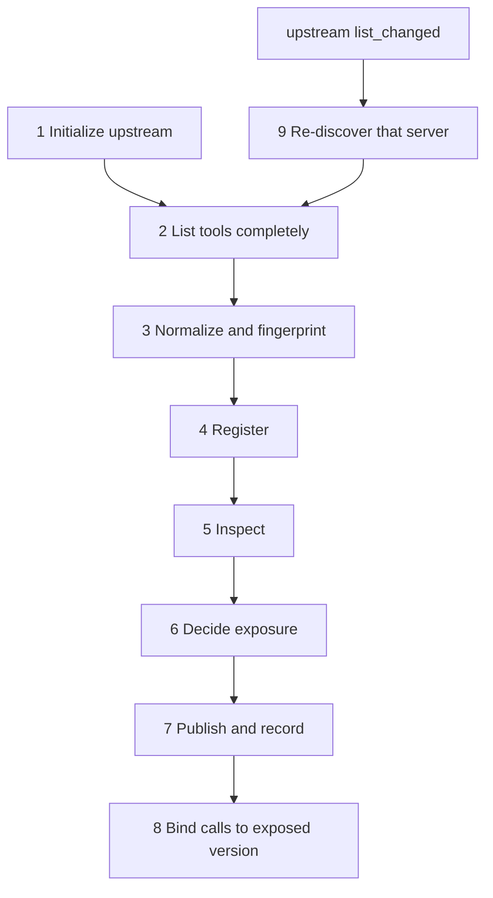

# Discovery lifecycle

Status: proposed, see
[ADR 0014](../decisions/0014-discovery-lifecycle-and-direct-metadata-defenses.md)
for the decisions and their motivation.

How the proxy turns what upstream servers report about themselves into what
the agent is shown. Direct defenses act here: server and tool metadata reach
the LLM as soon as the agent lists tools, before any call.

## Steps

### 1. Initialize

Proxy keeps each upstream `InitializeResult` as an untrusted **server
record**: the configured `server_id`, the negotiated protocol version, the
reported `serverInfo` (`name`, `title`, `version`, `description`, `icons`,
`websiteUrl`), the capabilities, and `instructions`. The configured
`server_id` is the server's identity; the reported name is metadata.

### 2. List completely

Proxy follows `nextCursor` until the last page, within configured limits on
pages and response size. If a server's list cannot be read completely, none
of its tools are exposed, and the failure is recorded. Exposing part of a
list would leave unread tools unchecked.

### 3. Normalize and fingerprint

- Unknown top-level fields, those the pinned MCP specification does not
  define for a tool or for `InitializeResult`, are removed.
- Text is normalized once. Invisible and formatting characters (the Unicode
  TAG block, zero-width and bidirectional controls) and terminal escape
  sequences are findings in their own right, not silently removed.
- The canonical JSON of each normalized tool definition is hashed. The hash
  is the tool's **definition version**. The server record is hashed the same
  way.

The bytes that are hashed and inspected are exactly the bytes forwarded.

### 4. Register

Registry stores the server record and each definition under its `ToolId` and
version. Name collisions are refused as in V1.

### 5. Inspect

Runner runs discovery-stage defenses after every server is registered, so a
check can compare servers. Each defense returns an explicit status; until
defenses exist, the status is `not_inspected`, never an empty clean result.

Inspection covers every text value at any depth: tool `name`, `title`,
`description`, `annotations`, `_meta`, and every JSON Schema keyword in
`inputSchema` and `outputSchema` (`description`, `title`, `examples`,
`default`, `enum`, and non-standard keywords). Server instructions are
inspected on their own, apart from the tool definitions. Each finding names
the field path it came from.

The scan is staged, so the slower checks run on little of the metadata:

| Stage | Check | Runs on |
| --- | --- | --- |
| 1 | Deny list of known override phrases | all text |
| 2 | Fast yes/no classifier | all text |
| 3 | Targeted semantic check | expressions flagged by stages 1-2 |

Exposure waits for the scan within a configured time budget. A failed or
timed-out inspection is recorded as `failed` and handled as a
high-confidence finding.

### 6. Decide exposure

Guard decides once per tool version and once per server record, from the
principal's policy rule, the inspection results, and the inspection status.

| Subject | Condition | Outcome |
| --- | --- | --- |
| Tool | no finding, or low-confidence finding | `expose`: unchanged; finding recorded |
| Tool | high-confidence finding, or failed inspection | `expose_with_warning`: visible with a fixed proxy warning; every call `require_approval` |
| Tool | no policy rule for the principal | `hide`: not listed, and an unknown tool on call (V2) |
| Server instructions | clean | `forward`: in the proxy's `InitializeResult`, labelled with the server id |
| Server instructions | any finding, or failed inspection | `withhold`: not forwarded; decision recorded |

Listing and calling use the same exposure decision, so a tool's visibility
and its callability cannot diverge (V2, ADR 0010). The warning text is a
fixed proxy string, never server-supplied text. Until Approval exists (V5),
`require_approval` blocks.

### 7. Publish and record

Proxy builds its own `InitializeResult`, including the forwarded instructions,
and its own `tools/list` from the exposure decisions. The discovery audit
record lists, per tool, the `ToolId`, definition version, and exposure
outcome, with the finding references, and, per server, the server-record hash
and the instructions outcome. The audit log can then show exactly which
metadata the agent received.

### 8. Bind calls to the exposed version

A call is routed only if the tool's current version is the version the agent
was shown. Otherwise the call is held until the new version has gone through
steps 3-6. Call decision records carry the version.

### 9. Re-discover

On an upstream `notifications/tools/list_changed`, Proxy repeats steps 2-7
for that server, then sends its own `list_changed` to the agent. Until then
the earlier exposure stands, and step 8 holds calls whose version changed.
For servers that do not declare `listChanged`, re-listing is periodic or on
each agent `tools/list`, as configured.

## Current status

V1 (on `main`) and V2 (PR #3) behave the same except at step 6.

| Step | V1 and V2 behavior |
| --- | --- |
| 1 | `InitializeResult` discarded; the proxy sends no `instructions` |
| 2 | first page only; `nextCursor` ignored |
| 3 | no normalization, field stripping, or definition version |
| 4 | routing table keyed by external name, no version |
| 5 | none |
| 6 | V1: every tool listed. V2: Policy `can_discover` filters listing directly; Guard decides calls only |
| 7 | discovery record holds the visible tool count only |
| 8 | calls bound to the tool name only |
| 9 | tool definitions fixed at startup; `list_changed` ignored |

## Evaluation

The attack experiments are run again with the proxy between the agent and
the servers. They were designed independently of the proxy, so they serve as
held-out tests; the proxy is not tuned to their payloads.

**Arms.** Each experiment keeps its protocol, seeds, prompts, and model
runtime. Three arms are compared:

1. **Direct:** the existing cohort without a proxy, cited as recorded.
2. **Pass-through:** the proxy with no defenses enabled. This separates the
   proxy's own effect, such as the `server__tool` names, from the defenses'.
3. **Defended:** the proxy with the discovery defenses enabled.

**Measures.**

- Attack outcome, from the upstream servers' own audit logs, not from
  detector findings.
- What the agent was shown: the exposure outcome and version of every tool
  and server record, from the proxy's discovery records.
- False warnings and approvals on runs without the attack and on the
  authorized-control runs.
- Task completion. A flagged tool requires approval, so the protocol states
  whether approvals are granted or refused, and reports both where relevant.
- Added latency at discovery.

**Runtimes.** The cohorts used different runtimes, and each rerun pins its
own:

| Experiment | Runtime |
| --- | --- |
| Tool description poisoning | LM Studio, `qwen3.5-9b-mlx` (MLX 4-bit) |
| Server instructions injection | LM Studio, `qwen3.5-9b-mlx` (MLX 4-bit) |
| Malicious server registration | Ollama 0.40.6, `qwen3.5:9b-q4_K_M` (GGUF Q4_K_M) |
