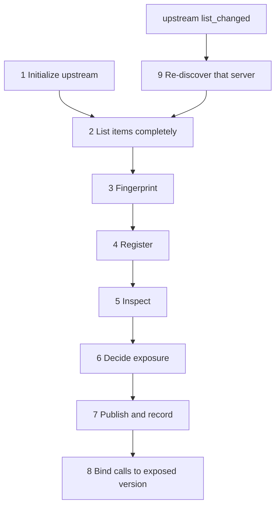

# Discovery lifecycle

Status: proposed. The steps marked V2 are decided; later steps are the
intended design, to be confirmed in the phase that implements them (see
"Phases").

How the proxy turns what upstream servers report about themselves into what
the agent is shown. This lifecycle is shared by every defense category:
direct defenses inspect what metadata says, temporal defenses whether it
changed, and environment defenses which servers are connected. The defaults
for direct defenses are in
[`direct-metadata-defenses.md`](direct-metadata-defenses.md) and
[ADR 0016](../decisions/0016-direct-metadata-defense-defaults.md).

## Scope

Discovery covers every item a server describes before it is used:

| Item | Listed by | Change notification |
| --- | --- | --- |
| Server record | `initialize` | none (fixed for the connection) |
| Tools | `tools/list` | `notifications/tools/list_changed` |
| Prompts | `prompts/list` | `notifications/prompts/list_changed` |
| Resources | `resources/list`, `resources/templates/list` | `notifications/resources/list_changed` |

The proxy currently proxies tools only; prompts and resources are not
forwarded, so they cannot carry metadata to the agent. When they are proxied,
they follow the same steps, with the item's own fields in place of a tool's.

## Steps

### 1. Initialize

Proxy keeps each upstream `InitializeResult` as an untrusted **server
record**: the configured `server_id`, the negotiated protocol version, the
reported `serverInfo`, the capabilities, and `instructions`. The configured
`server_id` is the server's identity; everything the server reports,
including its name, is metadata.

### 2. List completely

Proxy follows `nextCursor` until the last page, within configured limits on
pages and response size. If a server's list cannot be read completely, none
of that server's items of that kind are exposed, and the failure is
recorded. Exposing part of a list would leave unread items unchecked.

### 3. Fingerprint

Each item's **definition version** is a hash of its canonical upstream form,
written with its algorithm, for example `sha256-jcs:<hex>`. The server record
is fingerprinted the same way. The version identifies what the server sent:
the proxy's own changes to what the agent sees, such as the disambiguated
name or a fixed warning, are applied afterwards and do not change it.

If a later phase changes canonicalization or normalization, the algorithm
name changes with it, so versions computed under different rules are never
compared as equal.

### 4. Register

Registry stores the server record and each item under its server-scoped id
and version. Name collisions are refused as in V1.

### 5. Inspect

Runner runs discovery-stage defenses once every server is registered, so a
check can compare servers. Findings are computed once per item version. Each
defense returns an explicit status (`completed`, `not_applicable`,
`unsupported`, `failed`); until defenses exist, the status is
`not_inspected`, never an empty clean result. Each finding names the field
path it came from.

### 6. Decide exposure

Guard makes one **exposure decision** per (principal, item version), and one
per (principal, server record) for its instructions. The inputs are the
principal's policy, the inspection results, and their statuses. Policy maps
findings to outcomes; Guard holds no defaults of its own.

| Subject | Outcomes |
| --- | --- |
| Tool, prompt, resource | `expose`, `expose_redacted`, `hide` |
| Server instructions | `forward`, `withhold` |

- `expose`: forwarded as sent, apart from the disambiguated name.
- `expose_redacted`: forwarded with each flagged field replaced by a fixed
  proxy string; never server-supplied text.
- `hide`: not listed, and unknown on use (V2, ADR 0010).
- `forward` / `withhold`: whether the server's instructions appear in the
  proxy's own `InitializeResult`.

An exposed tool also carries the call outcome its calls receive (`allow` or
`require_approval`), taken from the same decision. Listing and calling use
this one decision, so visibility and callability cannot diverge.

### 7. Publish and record

Proxy builds its own `InitializeResult` and lists from the exposure
decisions. Forwarded instructions are placed in a structure the proxy writes,
with each server's configured id outside the server's text, so a server
cannot present its text as another server's. The discovery audit record
lists, per item, the server-scoped id, definition version, exposure outcome
and finding references, and, per server, the server-record version and the
instructions outcome.

### 8. Bind calls to the exposed version

A call is dispatched only if the tool's current version is the one the
principal was shown. Otherwise it is rejected at once with a fixed tool
error, and the new version goes through steps 3-6; it is not held open
waiting. Call decision records carry the version.

### 9. Re-discover

On an upstream `list_changed` notification, Proxy repeats steps 2-7 for that
server and kind, then sends its own `list_changed` to the agent. For servers
that do not declare `listChanged`, re-listing is periodic or on each agent
list request, as configured.

## Phases

| Step | Phase |
| --- | --- |
| 1 Server record kept and recorded (instructions not forwarded) | V2 follow-up |
| 2 Complete listing | V2 follow-up |
| 3 Definition versions | V2 follow-up |
| 6 One exposure decision by Guard for listing and calling | V2 follow-up |
| 7 Versions and outcomes in discovery and decision records | V2 follow-up |
| 4 Registry with server records and versioned items | V3 |
| 5 Discovery-stage inspection with explicit statuses | V3 |
| 8 Calls bound to the exposed version | V3 |
| 9 Re-discovery | V3 |
| Prompts and resources | when they are proxied |

## Current status

V1 (on `main`) and V2 (PR #3):

| Step | Behavior |
| --- | --- |
| 1 | `InitializeResult` discarded; the proxy sends no `instructions` |
| 2 | first page only; `nextCursor` ignored |
| 3 | no definition version |
| 4 | routing table keyed by external name, no version |
| 5 | none |
| 6 | V1: every tool listed. V2: Policy `can_discover` filters listing directly; Guard decides calls only |
| 7 | discovery record holds the visible tool count only |
| 8 | calls bound to the tool name only |
| 9 | tool definitions fixed at startup; `list_changed` ignored |
