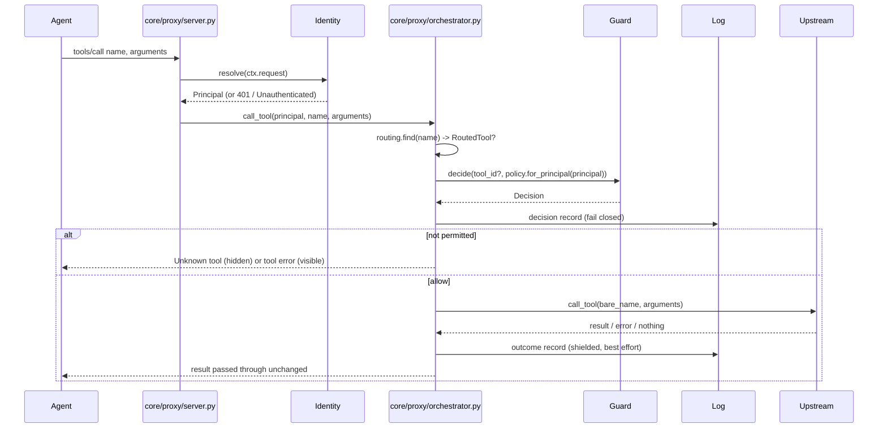

# Request lifecycle and control (V2)

Permanent reference for how the proxy authenticates callers, decides what
they may do, and records it. Promoted from the ADRs that settled this design
([0010](../decisions/0010-policy-model-and-default-deny.md),
[0011](../decisions/0011-identity-per-transport-and-no-task-boundary.md),
[0012](../decisions/0012-decision-semantics-and-denial-responses.md),
[0013](../decisions/0013-audit-records-masking-and-fail-closed.md)). Read those
for the *why*. This doc is the *what*, kept up to date as later phases extend it.

## Lifecycle



`tools/list` follows the same path without Guard: the orchestrator returns
only the tools `PrincipalPolicy.can_discover` accepts, and writes a
`discovery` record first.

## Modules

| Module | Code | Responsibility |
| --- | --- | --- |
| Contract types | `sdk/types.py` | `Principal(id, authenticated_by)`, `ToolId(server_id, name)`. No dependencies. |
| Identity | `core/identity/` | `IdentityResolver.resolve(transport_request) -> Principal`; `StaticTokenVerifier` for the SDK's bearer auth. |
| Policy | `services/policy/` | Load, validate, and version the policy file; answer `rule_for` / `can_discover` per principal. |
| Guard | `core/guard/` | `Guard.decide(tool_id, policy) -> Decision`. |
| Log | `services/log/` | Audit record schemas, argument masking, `AuditSink` / `JsonlAuditSink`. |
| Orchestrator | `core/proxy/orchestrator.py` | The lifecycle above. No rules of its own. |
| Server adapter | `core/proxy/server.py` | SDK handler callbacks → orchestrator, after resolving the principal. |
| Wiring | `app/wiring.py`, `app/agent_facing.py` | Construct and inject concrete implementations; pair each transport with its identity mechanism. |

Dependency direction: `app` → `core` → `services` → `sdk`. Services never
import core, so Log records use primitive fields and
`core/proxy/audit.py` maps core types onto them.

## Shared capability contracts

**Identity** — *Input:* the transport request object (Starlette request for
HTTP, `None` for stdio); never the MCP payload. *Output:* `Principal`.
*Errors:* `UnauthenticatedError` → `MCPError(INVALID_REQUEST)`; over HTTP the
SDK middleware answers 401 first. *Scope:* per message. *Concurrency:*
stateless. *Versioning:* `authenticated_by` names the mechanism
(`static_config`, `bearer_token`).

**Policy** — *Input:* `Principal`, then `ToolId`. *Output:* `PrincipalPolicy`;
`ToolRule | None`; `bool`. *Errors:* `PolicyError` at load or startup
validation only, never per request. *Scope:* per principal (no task scope,
0011). *Concurrency:* immutable after startup. *Versioning:* `sha256:` of the
canonical document, carried on every decision; `schema_version: 1`.

**Guard** — *Input:* `ToolId | None`, `PrincipalPolicy`. *Output:*
`Decision(outcome, rule_refs, reason, policy_version, decision_id)`.
*Errors:* none. *Concurrency:* stateless. *Precedence:* unknown tool →
block; no rule → block (default deny); exact rule beats server wildcard;
only `allow` dispatches.

**Log** — *Input:* `DiscoveryRecord`, `DecisionRecord`, `OutcomeRecord`.
*Output:* one JSON line per record. *Errors:* `AuditWriteError`; a failed
decision or discovery write refuses the request, while a failed outcome
write is reported on stderr. *Concurrency:* writes serialized by a lock and
flushed before returning. *Masking:* arguments → SHA-256 + sorted key names.

## Configuration

```yaml
agent_transport: stdio | streamable-http
identity:
  stdio_principal: local-agent          # required for stdio
  bearer_tokens:                        # required for streamable-http
    - principal: local-agent
      token_sha256: <sha256 hex of the token>
policy_path: config/policies/default.yaml
audit_log_path: proxy_audit.jsonl
servers: [...]
```

```yaml
# policy file
schema_version: 1
principals:
  local-agent:
    - tool: server_a/*                  # every tool on server_a
      effect: allow
    - tool: server_b/send_message       # visible, blocked until V5
      effect: require_approval
```

Relative paths resolve against the proxy's working directory. The proxy
refuses to start on an invalid config or policy, an unwritable audit log,
or a policy rule that matches no discovered tool.

## Limitations (deliberate, V2 scope)

- **No task boundary.** Permissions apply per principal, across sessions.
- **Static configuration.** Changing policy or tokens requires a restart.
- **Tools only.** Resources, prompts, and other methods are not proxied (as
  in V1), so there is nothing to bypass control through them.
- **`require_approval` always blocks** until the Approval module (V5).
- **Proactive outcome-unknown marking** of *other* in-flight calls when a
  connection drops (`CorrelationTracker.mark_server_unknown`) is still not
  wired up. Each interrupted call records its own `unknown` outcome.
