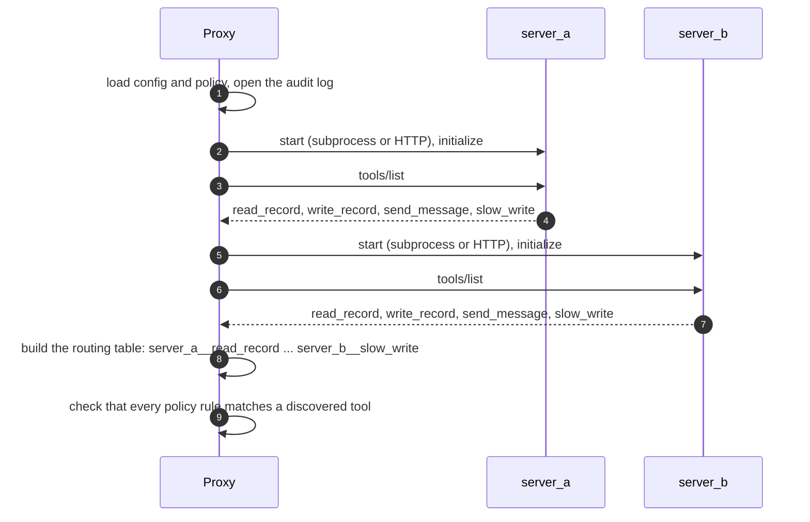
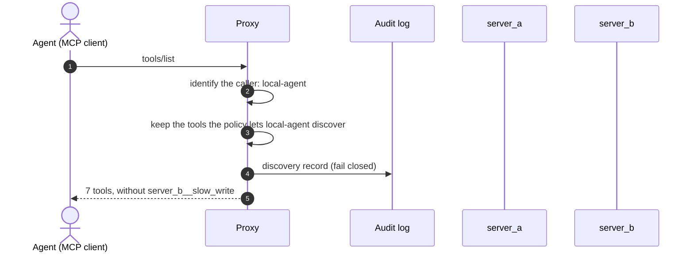
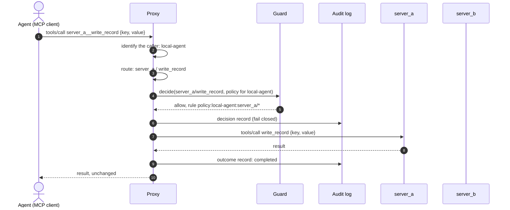
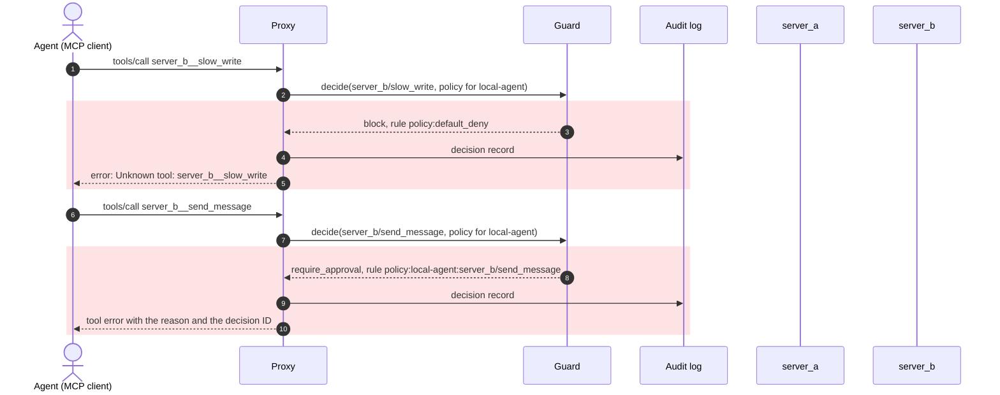

# How it works

This page follows a client's requests through the proxy as of V2. The examples use the two mock servers and the reference policy that ship with the repository. In every diagram the client is on the left and the MCP servers are on the right.

The reference policy for the principal `local-agent`:

| Tool | Effect | What the client sees |
|---|---|---|
| `server_a/*` (every tool on server A) | `allow` | Listed and callable |
| `server_b/read_record`, `server_b/write_record` | `allow` | Listed and callable |
| `server_b/send_message` | `require_approval` | Listed, but every call is refused until Approval exists (V5) |
| `server_b/slow_write` | not listed | Hidden; a call is answered as if the tool did not exist |

## 1. Startup

Before accepting a client, the proxy connects to every configured server and reads its tools once.

Both servers expose a tool called `send_message`. The proxy gives each tool an external name, `server_id__tool_name`, and remembers which server and original tool each name stands for ([Tool identity and routing](../design/tool-identity-and-routing.md)).

The proxy refuses to start if the configuration or policy is invalid, the audit log cannot be opened, or a policy rule matches no tool.

## 2. Discovery

The servers are not contacted: the list comes from the routing table built at startup. Each tool keeps its original description and input schema; only the name changes.

## 3. A permitted call

Only Guard decides, and only `allow` lets a call through. The decision record is written before the call is sent. If it cannot be written, the call is not sent and the client receives an internal error, so a full disk or a permissions change cannot silently switch the audit trail off. The outcome record is written after the call; if that write fails, the error is reported on stderr and the result is still returned, because the call has already taken effect.

## 4. Refused calls

Neither server is contacted. The two refusals look different on purpose ([ADR 0012](../decisions/0012-decision-semantics-and-denial-responses.md)):

| Situation | Guard outcome | Client receives |
|---|---|---|
| The name matches no tool | `block` (`routing:unknown_tool`) | Protocol error `Unknown tool: <name>` |
| The tool exists but no rule allows the caller to see it | `block` (`policy:default_deny`) | The same error, byte for byte, so a hidden tool cannot be told apart from a missing one |
| The tool is listed but needs approval | `require_approval` | A tool result marked as an error, with Guard's fixed reason and the decision ID, so an operator can find the audit record |

## Identity

The caller is identified from the connection, never from the message content.

| Transport | Caller |
|---|---|
| stdio | Whoever launches the proxy is the configured principal (`identity.stdio_principal`) |
| Streamable HTTP | The principal whose token matches the `Authorization: Bearer` header; the proxy stores only SHA-256 digests of tokens. A request without a valid token receives HTTP 401 before any MCP processing |

There is no task boundary yet: a principal's permissions apply across all of its sessions ([ADR 0011](../decisions/0011-identity-per-transport-and-no-task-boundary.md)).

## Audit records

The audit log is a JSON Lines file with three kinds of record:

| Record | Written for | Main fields |
|---|---|---|
| `discovery` | each `tools/list` | principal, policy version, number of visible tools |
| `decision` | each `tools/call`, permitted or not | requested name, resolved tool, outcome, rule references, reason, policy version, masked arguments |
| `outcome` | each call sent to a server | status (`completed`, `failed`, or `unknown` when the connection closed or the client cancelled after dispatch), tool error flag |

Arguments are never written in full: the log keeps a SHA-256 digest of the arguments and their key names, which is enough to confirm whether a known payload was sent ([ADR 0013](../decisions/0013-audit-records-masking-and-fail-closed.md)).

## What is not covered yet

- Tool definitions and results are passed through without inspection. Inspection arrives with the Runner and defenses (V3 and V4).
- Tools are read once at startup. A server that changes its tools later is not noticed until the proxy restarts.
- Only tools are proxied; resources and prompts are not exposed to the client.
- `require_approval` always refuses until the Approval module (V5).

The complete list is in [Request lifecycle and control](../design/request-lifecycle-and-control.md#limitations-deliberate-v2-scope).
