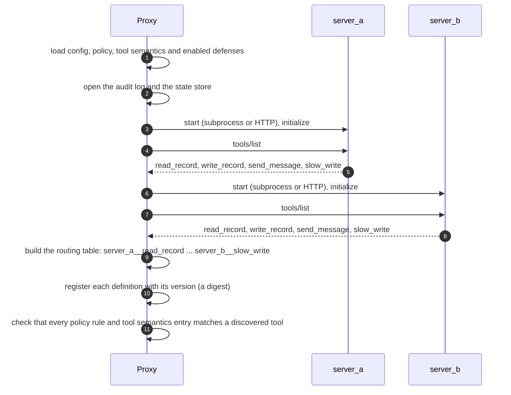
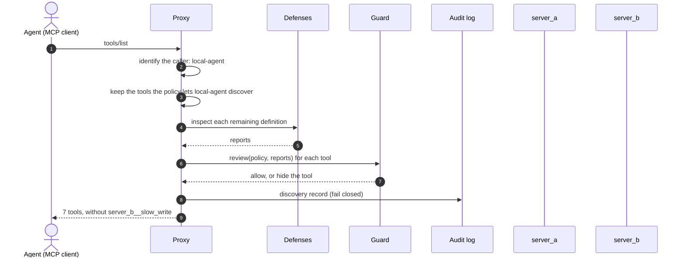
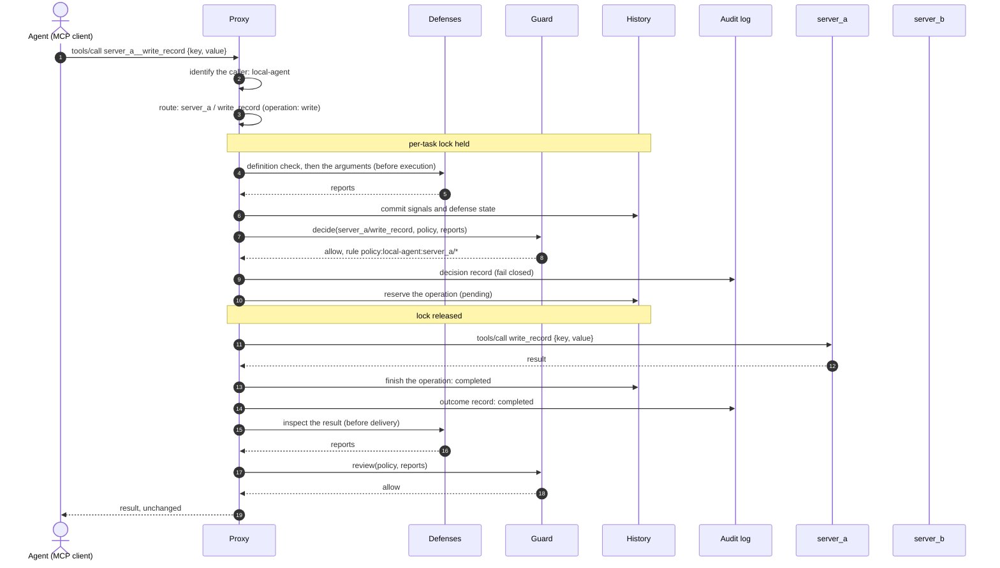
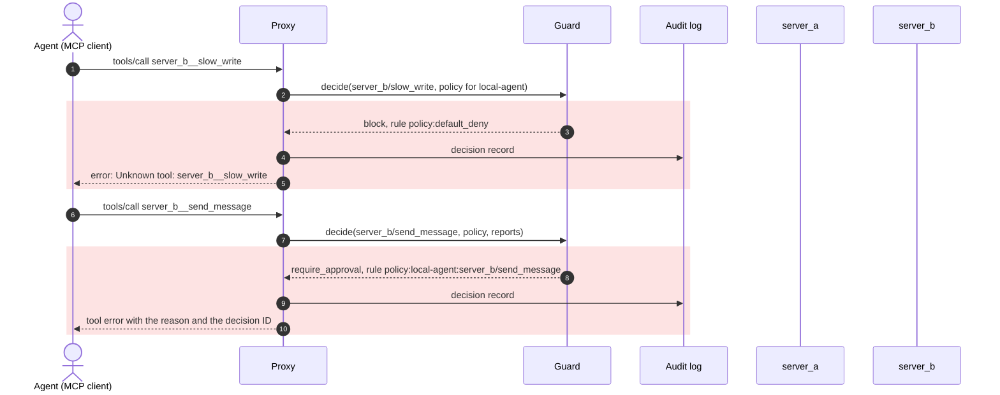

# How it works

This page follows a client's requests through the proxy as of V3. The examples use the two mock servers and the reference configuration that ship with the repository. In every diagram the client is on the left and the MCP servers are on the right.

The reference policy for the principal `local-agent`:

| Tool | Effect | What the client sees |
|---|---|---|
| `server_a/*` (every tool on server A) | `allow` | Listed and callable |
| `server_b/read_record`, `server_b/write_record` | `allow` | Listed and callable |
| `server_b/send_message` | `require_approval` | Listed, but every call is refused until Approval exists (V5) |
| `server_b/slow_write` | not listed | Hidden; a call is answered as if the tool did not exist |

The reference configuration enables no defenses: the sample `call_budget` defense is installed but disabled. The inspection steps below therefore produce no reports and Guard decides from the policy alone, but History still records every permitted call.

## 1. Startup

Before accepting a client, the proxy connects to every configured server and reads its tools once.

Both servers expose a tool called `send_message`. The proxy gives each tool an external name, `server_id__tool_name`, and remembers which server and original tool each name stands for ([Tool identity and routing](../design/tool-identity-and-routing.md)).

What each tool does (`read`, `write`, `send` or `execute`) comes from the operator's `config/tools.yaml`, never from the server's own names or descriptions. A tool that is not listed there is treated as `unknown`.

The proxy refuses to start if:

- the configuration, policy or tool semantics are invalid, or a policy rule or tool semantics entry matches no tool;
- an enabled defense is not installed, rejects its settings, needs an SDK version or capability the proxy does not offer, or depends on signals in a cycle;
- the audit log or the state store cannot be opened, or another proxy process already uses the same state file.

## 2. Discovery

The servers are not contacted: the list comes from the definitions read at startup. Each tool keeps its original description and input schema; only the name changes. A tool that a definition check does not allow is hidden exactly like a tool the policy does not list, and the discovery record names it. A definition's result is reused until its version or the policy changes, so a `tools/list` does not re-run the same check.

## 3. A permitted call

Only Guard decides, and only `allow` lets a call through. Guard takes the strictest of the policy rule and every defense report, as set by the policy's `enforcement` section:

| Report | Enforcement setting | Unset |
|---|---|---|
| A finding | `findings` for its rule ID, otherwise `by_severity` for its severity | `block` |
| A failed inspection (the defense raised an error, overran its deadline or returned malformed output) | `on_failure` | `block` |
| A defense that cannot inspect this event | `on_unsupported` | `block` |

A defense's file in `config/defenses/` may override these for its own findings ([ADR 0018](../decisions/0018-enforcement-defaults-and-defense-overrides.md)).

The decision record is written before the call is sent. If it cannot be written, the call is not sent and the client receives an internal error, so a full disk or a permissions change cannot silently switch the audit trail off. The same applies to History: if it cannot be read or updated, the request is refused before dispatch.

Deciding a call and reserving it in History happen under one lock per task, so parallel calls cannot slip past a rule that counts earlier calls. The task is currently the principal ([ADR 0017](../decisions/0017-task-boundary-and-state-backends.md)).

The outcome record is written after the call; if that write fails, the error is reported on stderr and the result is still returned, because the call has already taken effect. If no enabled defense inspects results, the result is released without a review and no delivery record is written.

## 4. Refused calls

Neither server is contacted. A tool the policy hides never reaches the defenses; a listed tool, such as `server_b__send_message`, is inspected first as in a permitted call. The refusals look different on purpose ([ADR 0012](../decisions/0012-decision-semantics-and-denial-responses.md)):

| Situation | Guard outcome | Client receives |
|---|---|---|
| The name matches no tool | `block` (`routing:unknown_tool`) | Protocol error `Unknown tool: <name>` |
| The tool exists but no rule allows the caller to see it, or a definition check hides it | `block` | The same error, byte for byte, so a hidden tool cannot be told apart from a missing one |
| The tool is listed but needs approval, or a defense's report blocks the call | `require_approval` or `block` | A tool result marked as an error: `Call blocked:` with Guard's reason and the decision ID, so an operator can find the audit record |
| The call ran, but a defense's report on the result is not allowed | `require_approval` or `block` | A tool result marked as an error: `Result withheld:` with the reason and the decision ID, stating that the call was executed |

A withheld result does not undo the call: it has already run on the server ([ADR 0020](../decisions/0020-inspection-stages-and-delivery-semantics.md)).

## Inspection stages

Defenses inspect three kinds of event. Each defense declares the stages it handles in its manifest:

| Stage | Inspects | When | If Guard does not allow it |
|---|---|---|---|
| `discovery` | A tool definition | At `tools/list`, and again before each call to that tool | The tool is hidden and calls to it are answered as an unknown tool |
| `before_execution` | The call's arguments and its operation from the Registry | Before the call is sent | The call is refused and not sent |
| `before_delivery` | The result's content, with its provenance | After the call, before the result is released | The result is withheld; the call has already run |

Defenses never forward, block or approve anything themselves. They return findings, signals for later inspections in the same task, and proposed changes to their own state, which are committed atomically before anything is released. How to write one is in [Adding a defense](../guides/adding-a-defense.md); the contracts are in [Defense SDK and Runner](../design/defense-sdk-and-runner.md).

## Identity

The caller is identified from the connection, never from the message content.

| Transport | Caller |
|---|---|
| stdio | Whoever launches the proxy is the configured principal (`identity.stdio_principal`) |
| Streamable HTTP | The principal whose token matches the `Authorization: Bearer` header; the proxy stores only SHA-256 digests of tokens. A request without a valid token receives HTTP 401 before any MCP processing |

A task is currently the principal: its permissions and its History apply across all of its sessions, and with the SQLite state store its History also survives restarts ([ADR 0011](../decisions/0011-identity-per-transport-and-no-task-boundary.md), [ADR 0017](../decisions/0017-task-boundary-and-state-backends.md)).

## Audit records

The audit log is a JSON Lines file with four kinds of record:

| Record | Written for | Main fields |
|---|---|---|
| `discovery` | each `tools/list` | principal, policy version, number of visible tools, tools hidden by a definition check |
| `decision` | each `tools/call`, permitted or not | requested name, resolved tool, operation, outcome, rule references, reason, policy version, masked arguments, a summary of each inspection |
| `outcome` | each call sent to a server | status (`completed`, `failed`, or `unknown` when the connection closed or the client cancelled after dispatch), tool error flag |
| `delivery` | each result inspected before release | outcome, rule references, reason, a summary of each inspection |

Arguments are never written in full: the log keeps a SHA-256 digest of the arguments and their key names, which is enough to confirm whether a known payload was sent ([ADR 0013](../decisions/0013-audit-records-masking-and-fail-closed.md)). Inspection summaries name the defense, its version, its status and the rule IDs it reported, without evidence or inspected content.

## What is not covered yet

- No defense detects attacks yet. V4 adds them together with the shared capabilities they need, starting with Scan ([Roadmap](roadmap.md#v4-delivery)).
- Tools are read once at startup. A server that changes its tools later is not noticed until the proxy restarts.
- Only tools are proxied; resources and prompts are not exposed to the client. Upstream protocol errors and notifications are not inspected.
- A task is the principal; there is no per-session history, and history is never compacted.
- Task locks are held inside one process, so only one proxy may use a given state file.
- A defense that blocks the event loop cannot be interrupted by its deadline.
- `require_approval` always refuses until the Approval module (V5).

The complete lists are in [Request lifecycle and control](../design/request-lifecycle-and-control.md#limitations-deliberate-v2-scope) and [Defense SDK and Runner](../design/defense-sdk-and-runner.md#limitations-deliberate-v3-scope).
