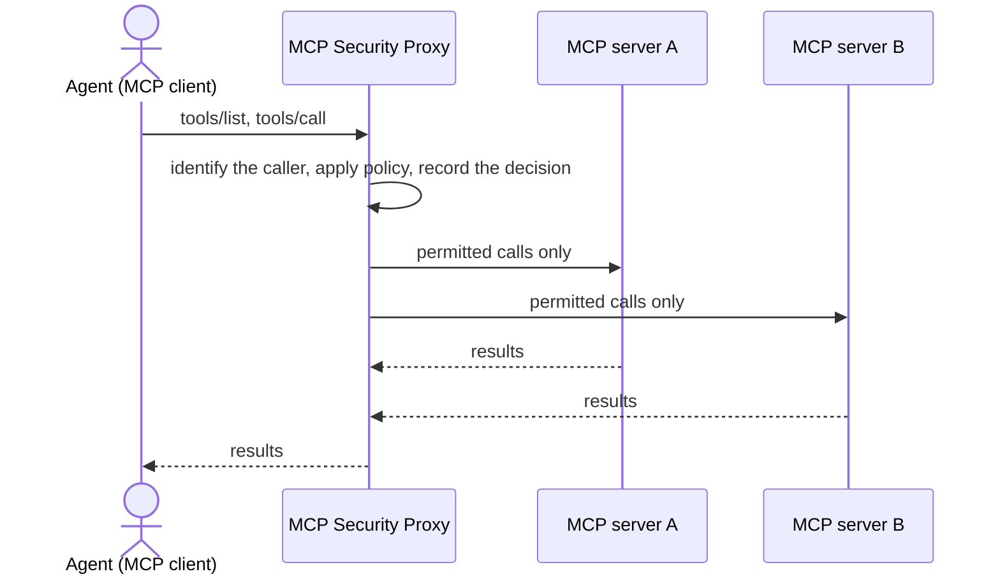

# MCP Security Proxy

The MCP Security Proxy sits between an MCP client, such as an LLM agent, and the Model Context Protocol (MCP) servers that client uses. All of the client's traffic to those servers passes through the proxy, which decides what the client may see and call, records every decision, and, in later phases, inspects tool definitions and results for attacks.

It is developed as part of the ENS492 MCP Security Tool project at Sabancı University.

## Why a proxy

An agent connected to several MCP servers trusts each of them twice: it reads their tool definitions to decide what to call, and it reads their results to decide what to do next. A malicious or compromised server can place instructions in either. A host application typically passes both to the LLM unchanged.

A proxy is the one place where every definition, call and result can be checked against a policy the server cannot change, regardless of which client or LLM is used. That only holds if all traffic goes through it, so the proxy enforces permissions on actual calls, not just on what it lists.

## What it does today

The proxy currently implements phases V1 and V2 of the [build plan](guide/roadmap.md):

| Capability | Behavior |
|---|---|
| Transports | stdio and Streamable HTTP, each as a complete configuration from client to servers |
| Tool routing | Tools from all servers under one list, renamed `server_id__tool_name` so identical names never collide |
| Identity | A fixed principal for stdio; static bearer tokens, stored as SHA-256 digests, for HTTP |
| Policy | A per-principal allowlist of server-scoped tools; anything not listed is hidden and rejected like a tool that does not exist |
| Decisions | One decision per call: `allow`, `block`, or `require_approval` (blocked until Approval exists) |
| Audit | Every discovery, decision and upstream outcome appended to a JSON Lines log with arguments masked; if a decision cannot be recorded, the call is not made |

There is no attack detection yet. Detection is added as defenses in V3 and V4.

## Defense categories

The architecture lets five groups of defenses be developed independently on shared capabilities, without changes to the core pipeline:

| Category | Addresses |
|---|---|
| Direct | Malicious instructions in tool definitions, schemas and server metadata |
| Indirect | Malicious instructions in returned content, resources, prompts and errors |
| Cross-tool | Unsafe combinations of operations across tools and servers |
| Temporal | Changed definitions, stale trust and approvals reused outside their scope |
| Environment | Untrusted server connections and, for locally launched servers, unsafe execution |

The defenses are designed from this architecture, not from specific attack payloads. The project's attack experiments are later re-run through the proxy as held-out tests.

## Where to start

- [How it works](guide/how-it-works.md): what happens to a request, step by step.
- [Getting started](guide/getting-started.md): install, run and connect a client.
- [Architecture](architecture.md): modules, contracts and the V1 to V5 build plan.
- [Decisions](decisions/README.md): why each implementation choice was made.
